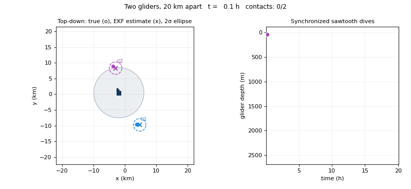
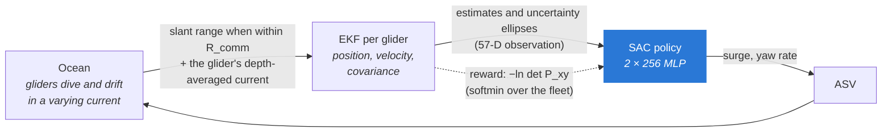
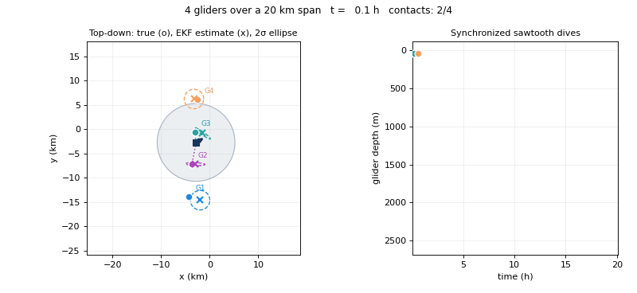

<div align="center">

# Learned ASV Guidance for Tracking Underwater Gliders

**A soft actor-critic policy steers an autonomous surface vehicle to keep range-only acoustic fixes on a fleet of diving gliders, maximizing the information its EKF gets from every ping.**

[](https://github.com/svillhauer/asv-glider-tracking/actions/workflows/ci.yml)




<sub>Two gliders 20 km apart, 8 km acoustic range. The ASV (square) can never hear both gliders at once, so it learns to shuttle between them. Left, top-down: the shaded disk is the horizontal reach of the acoustic link, which shrinks as the gliders dive; o is the true glider, x its EKF estimate with a 2σ ellipse, and a dotted line a range fix. Right: the last two days in 3D, with the gliders' sawtooth dives below the ASV's surface track.</sub>

</div>

---

## TL;DR

- **One ASV, range-only acoustics, gliders that are out of reach most of the time.** At the reference scale each glider is within acoustic range only ~34% of the time, yet the EKF keeps both positions to a median of **300 m (1.5% of their 20 km separation)** over 240-hour missions, with **0 of 15 evaluation missions** losing a glider.
- **The reward is an information criterion, not a distance.** The agent maximizes −ln det of each glider's EKF position covariance (D-optimality), so the shuttling and loitering behaviors emerge from where the most informative ranges are, not from hand-written waypoints.
- **One policy for any fleet size.** The multi-glider policy tracks 2 to 5 gliders spread over the same span with a single network, using fixed observation slots and a soft-minimum reward over the fleet.
- **Scale-free by construction.** Everything is nondimensional (length = fleet span, speed = ASV top speed), so the same weights apply to a 2 km or a 20 km deployment.
- **Reproducible:** both trained policies ship in `models/`, a fixed-seed evaluation regenerates `results/`, and a test pins the reference mission to its published return (53,410).

## The problem

Underwater gliders cannot use GPS while submerged. A surface vehicle can localize them acoustically, but a single modem gives only a **range**: each fix places a glider somewhere on a circle. Recovering a position takes ranges from different directions, and the acoustic link only works within a few kilometers. With several gliders spread wider than that range, the ASV has to decide continuously **which glider to visit, and from where to listen**.



## Environment

| | Nondimensional | Reference scale |
|---|---|---|
| Fleet span (length unit) | 1 | 20 km |
| ASV top speed (speed unit) | 1 | 2.5 m/s |
| Control step | 0.0375 | 300 s |
| Mission | 2,880 steps | 240 h |
| Acoustic range R<sub>comm</sub> | 0.30–0.60 (randomized), 0.40 at test | 8 km at test |
| Glider speed | 0.12 | 0.30 m/s |
| Dive cycle (synchronized sawtooth) | 120 steps to 0.12 | 10 h to 2,400 m |
| Current (banded random walk, ≤) | 0.08 per axis | 0.2 m/s |
| Range noise | 0.0075 | 150 m |

- **Gliders** fly straight, parallel legs and are advected by a current that varies across the area. Each glider dead-reckons underwater and computes its own depth-averaged current (DAC) at the surface. The ASV only receives that DAC when it next hears the glider, so the EKF's drift model can be stale.
- **EKF** per glider: constant-velocity state, slant-range update with the glider's depth known, Joseph-form covariance.
- **Observation:** ASV heading, last command, current measured at the ASV, coverage ratio and fleet size, then for each glider slot the estimated range, range rate, bearing, depth, uncertainty ellipse and heading, plus a slot mask.
- **Action:** forward-only surge and a yaw rate capped at 26° per step.
- **Reward:** D-optimal uncertainty term (min over two gliders, normalized softmin over a fleet), minus a penalty for being out of range, minus control effort.

The whole environment is one class, `glidertrack.GliderTrackingEnv`. The two reference cases are just configs.

## Results

Both policies are evaluated with deterministic actions on 15 fixed missions (seeds 900–914) at R<sub>comm</sub> = 0.4 (8 km). Medians over missions. A mission counts as losing a glider if any position estimate is ever off by more than 20% of the span.

### Two gliders

| Reward / step | Time in range (per glider) | True position error | EKF reported std | Missions losing a glider |
|:-:|:-:|:-:|:-:|:-:|
| 19.07 | 34.1% | **300 m** (1.5% of span) | 244 m | **0 / 15** |

### Multi-glider (one policy, 2–5 gliders over the same 20 km span)

<p align="center"></p>

| Gliders | Neighbor spacing | Reward / step | Time in range (per glider) | True position error | EKF reported std | Missions losing a glider |
|:-:|:-:|:-:|:-:|:-:|:-:|:-:|
| 2 | 20 km | 19.19 | 34.9% | 324 m | 256 m | 2 / 15 |
| 3 | 10 km | 19.69 | 54.7% | 271 m | 197 m | 1 / 15 |
| 4 | 6.7 km | 19.99 | 59.0% | 247 m | 182 m | 4 / 15 |
| 5 | 5 km | 20.22 | 63.3% | 228 m | 176 m | 1 / 15 |

- **Denser fleets are easier per glider:** with more gliders inside the same span, the ASV hears each one more often and the median error drops.
- **The single-fleet-size specialist is more reliable at N = 2:** the dedicated two-glider policy loses no missions where the multi-glider one loses 2 of 15. Generality across fleet sizes costs some robustness at the sparsest layout.
- **Failures are long-tail, not typical:** the median mission stays at a few hundred meters of error for every fleet size; the missions that lose a glider do so for an extended stretch rather than drifting gradually.

Regenerate these tables with `scripts/evaluate.py`; the raw numbers are in [`results/`](results).

## Quickstart

```bash
git clone https://github.com/svillhauer/asv-glider-tracking.git
cd asv-glider-tracking
pip install -e ".[dev]"
```

```python
from glidertrack import GliderTrackingEnv, Policy, eval_config, run_episode

env = GliderTrackingEnv(eval_config("multi_glider", n_gliders=4))
ep = run_episode(env, Policy.load("multi_glider"), seed=911)
print(ep.rewards.sum(), ep.true_error.mean())
```

```bash
python scripts/evaluate.py --case two_glider          # results/two_glider.json
python scripts/render.py --case multi_glider --gliders 4 --seed 911
python scripts/train.py --case two_glider --out runs/two_glider   # 30M steps, the recipe behind models/
pytest -q
```

Training uses SAC (Stable-Baselines3) with a 2 × 256 MLP, a 3M-transition replay buffer, γ = 0.99, and a curriculum that lengthens episodes from 500 to 2,880 steps over 95% of training. The best checkpoint by evaluation return is kept, in the same `policy.zip` + `obs_norm.npz` layout as `models/`.

## Repository layout

```
src/glidertrack/
  env.py          GliderTrackingEnv: ASV, gliders, current field, per-glider EKF, reward
  configs.py      the two reference cases and the physical reference scale
  policy.py       trained SAC actor + its observation normalization
  rollout.py      run an episode, record trajectories and covariances
  metrics.py      per-episode and summary metrics
  training.py     SAC recipe, episode-length curriculum, per-fleet-size evaluation
  animate.py      the GIFs above
scripts/          evaluate.py, render.py, train.py
models/           two_glider/ and multi_glider/ (policy.zip, obs_norm.npz)
results/          fixed-seed evaluation of both models
tests/            env, metrics, policy and training tests
```

## License

MIT. See [LICENSE](LICENSE).
