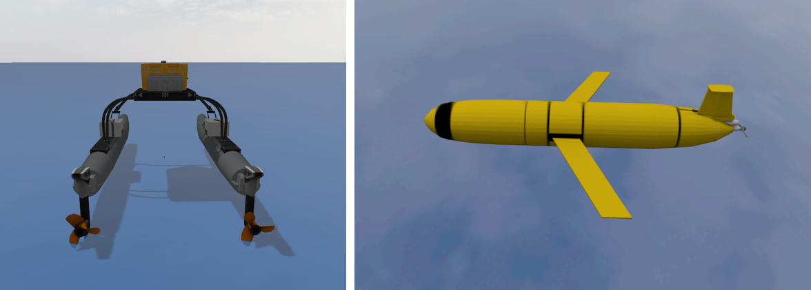
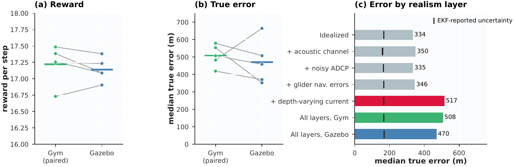
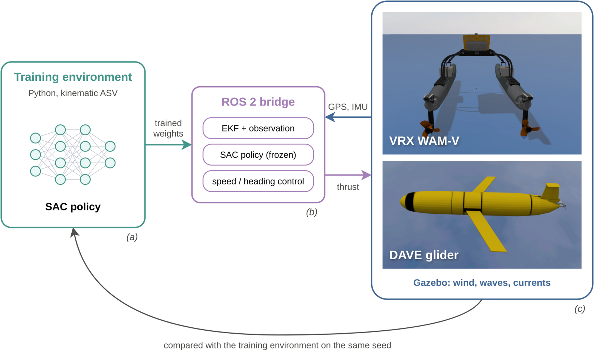
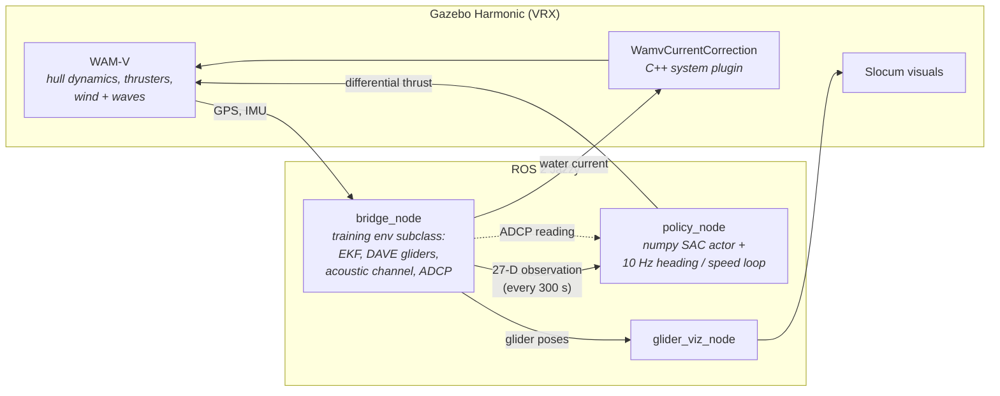

<div align="center">

# Sim-to-Sim Transfer: Gazebo + ROS 2

**The two-glider policy, unchanged, steering a physically simulated WAM-V through wind, waves and currents, with Slocum gliders flying Project DAVE's glider model.**




</div>

---

## Result

Five paired 12.5 h missions at the reference scale (gliders 20 km apart, 8 km acoustic range), with every realism layer on at once. Each Gazebo mission is paired with a kinematic run that shares its seed, current field, glider motion and sensing errors, so the pair differs only in the vehicle.

| | Paired kinematic run | Gazebo | Gazebo − paired (95% CI) |
|---|---|---|---|
| Reward per step | 17.22 | 17.14 | **−0.5%** [−1.7%, +0.8%] |
| Time in acoustic range | 29.3% | 29.3% | +0.1 pp [−0.7, +0.8] |
| Longest gap without contact | 2.30 h | 2.22 h | −0.08 h [−0.25, +0.08] |
| Median EKF uncertainty | 166 m | 169 m | +3 m [−4, +10] |
| Median true position error | 508 m | 470 m | −38 m [−209, +134] |

**The vehicle doesn't limit transfer.** The WAM-V's dynamics, the wind and the waves change no metric beyond the noise between missions, and no Gazebo mission loses a glider (the largest error of either glider stays at 10–15% of their separation). The realistic sensing and glider models do raise the true error, from 334 m with the training environment's sensing to about 500 m. Enabling one layer at a time attributes almost all of that rise to the **depth-varying current**: the EKF advects each glider at the constant drift of its last depth-averaged current, which a current that weakens and veers with depth breaks ([`results/realism_layers.csv`](results/realism_layers.csv)).

<p align="center"></p>

## How it works

<p align="center"></p>

The bridge does **not** re-implement the training environment. It subclasses it and replaces only the ASV's kinematic step with the pose measured in Gazebo. So the EKF, the observation and the reward are the exact code the policy was trained on, checked to 6e-8 against the original.



| Component | What it does |
|---|---|
| [`bridge_node`](ros_ws/src/asv_bridge_stable/asv_bridge_stable/bridge_node.py) | Ticks the environment every 300 s of sim time from the WAM-V's GPS and IMU, runs both EKFs, publishes the observation and per-tick metrics |
| [`ekf_core_stable`](ros_ws/src/asv_bridge_stable/asv_bridge_stable/ekf_core_stable.py) | The training environment subclass: Gazebo stepping, frame conversion, realistic acoustics, ADCP noise, depth-varying current, glider navigation errors |
| [`dave_glider`](ros_ws/src/asv_bridge_stable/asv_bridge_stable/dave_glider.py) | Line-for-line port of Project DAVE's glider flight model, with a yo-yo controller and the glider's own dead reckoning |
| [`policy_node`](ros_ws/src/asv_bridge_stable/asv_bridge_stable/policy_node.py) | The SAC actor in plain numpy (no PyTorch in the robot stack), plus a cascaded heading and through-water speed controller |
| [`WamvCurrentCorrection`](ros_ws/src/wamv_current/src/WamvCurrentCorrection.cc) | Gazebo system that adds ocean current to VRX's hull model (relative-velocity Coriolis and damping, Fossen 2011) without modifying VRX |

## Realism layers

All of them are on in the results above, and each can be switched on alone.

| Layer | Model | Launch argument |
|---|---|---|
| Vehicle | VRX WAM-V hull and thrusters, ±1500 N per side | always (Gazebo mode) |
| Sea state | 8 m/s wind with gusts; Pierson-Moskowitz sea, Hs ≈ 1.3 m | `worlds/rough/` |
| Ocean current on the hull | the training environment's current field through the C++ plugin | always |
| Glider flight | Project DAVE flight model, 1000 m yo-yo, 4.1 h dive cycle | `glider_model:=dave` |
| Current vs depth | 25% of the surface current at depth, veering 30° | `current_profile:=decay` |
| Glider navigation | compass bias, speed error, GPS fix noise in the glider's DAC | `glider_nav_error:=true` |
| Acoustic channel | range-dependent reception, travel-time delay, sound-speed error, multipath, lost DAC messages | `acoustic_model:=realistic` |
| ADCP | per-mission bias plus white noise | `adcp_noise:=true` |

## Quickstart

Requires Docker with the NVIDIA Container Toolkit. Commands run from the repository root.

```bash
# 1. image: ROS 2 Jazzy + Gazebo Harmonic + ros_gz
docker build -t glidertrack-gazebo:jazzy gazebo/docker

# 2. VRX and this workspace, built once into gazebo/ (mounted at /work)
gazebo/docker/run.sh bash -ic "bash docker/setup_vrx.sh && \
    source vrx_ws/install/setup.bash && cd ros_ws && colcon build --symlink-install"
```

**Plumbing test, no Gazebo** (the ASV follows the training kinematics; finishes in about 10 s):

```bash
gazebo/docker/run.sh bash -ic "source ros_ws/install/setup.bash && \
    ros2 launch asv_bridge_stable stable_nondim.launch.py gazebo_mode:=false use_sim_time:=false \
    tick_period:=0.05 current_max:=0.0 max_ticks:=120"
```

**Full mission in Gazebo, with the GUI:**

```bash
# terminal 1
gazebo/docker/run.sh bash -ic "ros2 launch vrx_gz vrx_environment.launch.py \
    world:=/work/worlds/rough/open_ocean.sdf sim_mode:=full config_file:=/work/config/wamv_spawn.yaml"
# terminal 2: docker exec -it <container> bash, then
source /work/ros_ws/install/setup.bash
ros2 launch asv_bridge_stable stable_nondim.launch.py max_ticks:=150 \
    acoustic_model:=realistic adcp_noise:=true current_profile:=decay glider_nav_error:=true
```

**Headless batch**, one fresh Gazebo per seed with every topic recorded and extracted, which is how the results were produced:

```bash
docker run --rm --gpus all -e NVIDIA_DRIVER_CAPABILITIES=all -v $(pwd)/gazebo:/work \
    glidertrack-gazebo:jazzy bash /work/scripts/run_seeds.sh 900 901 902 903 904
```

At 20 km one tick is 300 s of sim time, and Gazebo runs at about 2× real time, so a 150-tick mission (12.5 h, three dives) takes about 6 h of wall time.

## Validation

[`tools/validate_core.py`](tools/validate_core.py) checks the bridge against the training environment on the host, with no Gazebo, and with the policy acting closed loop:

```bash
python3 gazebo/tools/validate_core.py     # PASS in ~10 min
```

| Check | Result |
|---|---|
| Gazebo step fed the environment's own pose reproduces observation and reward | max diff 6e-8 |
| GPS frame round trip | float rounding only |
| numpy actor and normalizer vs Stable-Baselines3 | max diff 3e-6 |
| DAVE flight model: glide speed, dive period, depth | 0.30 m/s, 4.08 h, 1000 m |
| DAC recovered from a uniform current | 2e-14 m/s |
| Acoustic reception rate vs model, every range bin | ≤ 1.6 standard errors |
| Policy return, training gliders vs DAVE gliders | within 1% on all seeds |

The C++ plugin has its own headless tests ([`scripts/test_current_plugin.sh`](scripts/test_current_plugin.sh), [`scripts/test_current_e2e.sh`](scripts/test_current_e2e.sh)). With zero thrust in a (0.20, 0.10) m/s current, the WAM-V drifts at (0.197, 0.099) m/s.

## Layout

```
gazebo/
  docker/              Dockerfile, run.sh (GPU + X11), setup_vrx.sh
  ros_ws/src/
    asv_bridge_stable/ bridge, policy and visualization nodes; launch file
    wamv_current/      C++ Gazebo system: ocean current on the WAM-V hull
  worlds/              calm and rough open-ocean worlds
  models/              Slocum glider visual (Project DAVE meshes)
  policy/              the shipped two-glider policy exported to numpy
  scripts/             batch runner, bag extraction, plugin tests, live glider monitor
  tools/               policy export and host-side validation
  results/             per-mission metrics, paired CIs, realism-layer attribution
```

The policy weights are the same as [`models/two_glider/policy.zip`](../models/two_glider/policy.zip). [`tools/extract_policy.py`](tools/extract_policy.py) regenerates the numpy exports from it.

## Limitations

- The current is steady in time and banded in space, and its depth profile is assumed rather than fitted to a site.
- Acoustic, ADCP and glider-navigation parameters are assumptions, not fitted to a specific modem, ADCP or glider.
- The gliders aren't Gazebo bodies. Their motion comes from the DAVE flight model inside the bridge, and their visuals are repositioned every 10 s of sim time.
- Five 12.5 h missions bound the vehicle's effect on reward to about ±2%, but are too few to resolve rare failures.

## Credits

[VRX](https://github.com/osrf/vrx) (WAM-V model, wind and waves) and [Project DAVE](https://github.com/Field-Robotics-Lab/dave) (Slocum meshes and the glider flight model in `glider_hybrid_whoi`) are Apache-2.0. VRX is cloned at build time, not vendored.
